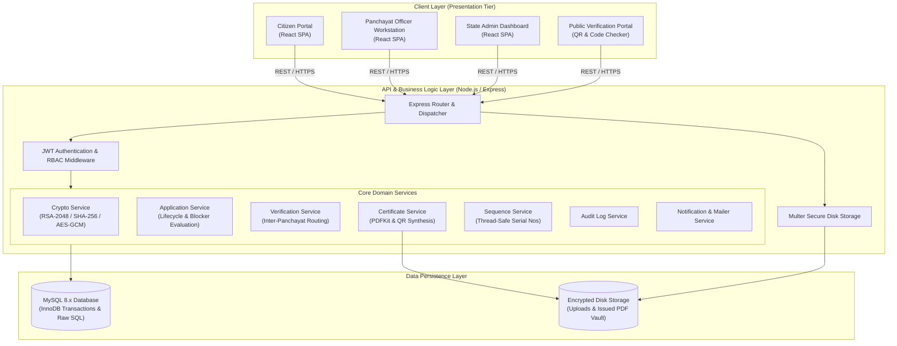
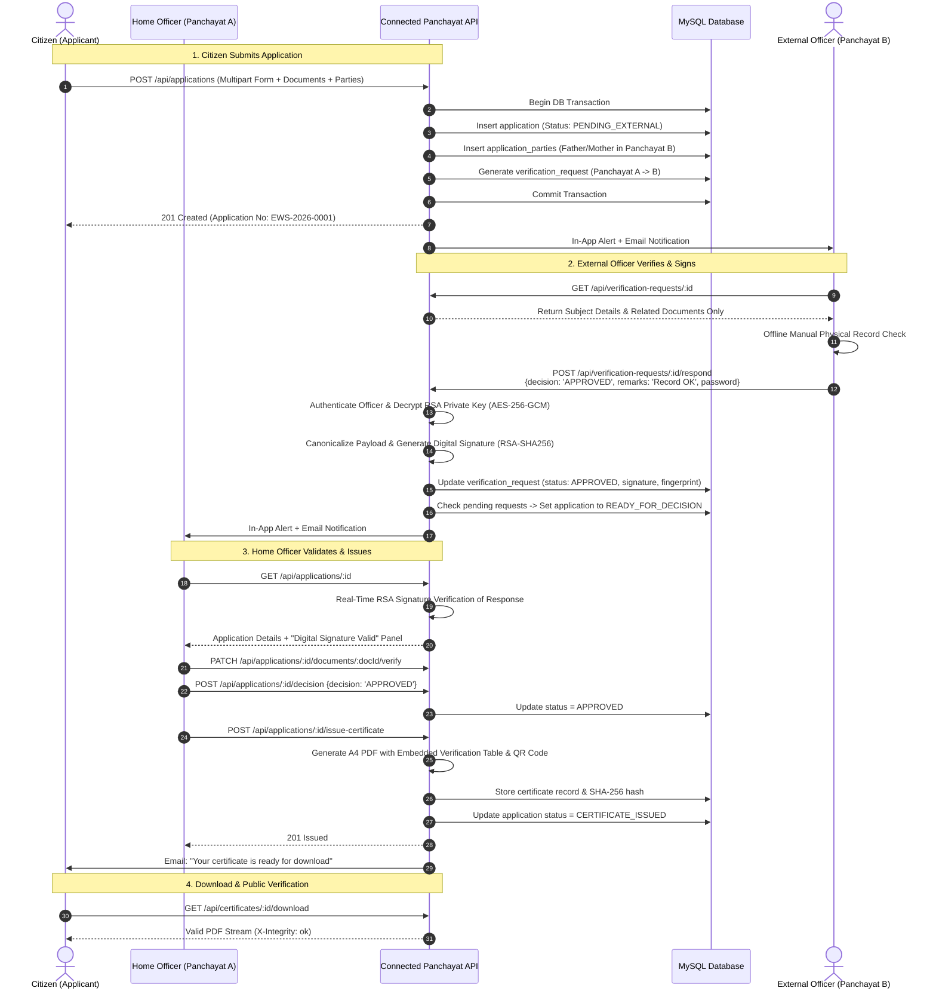
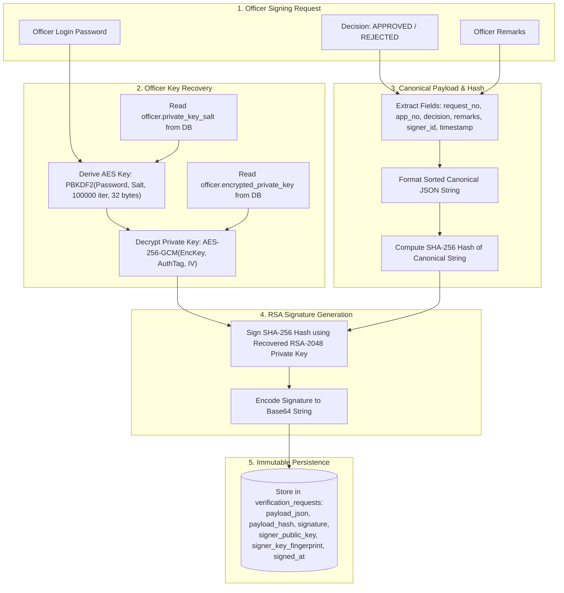
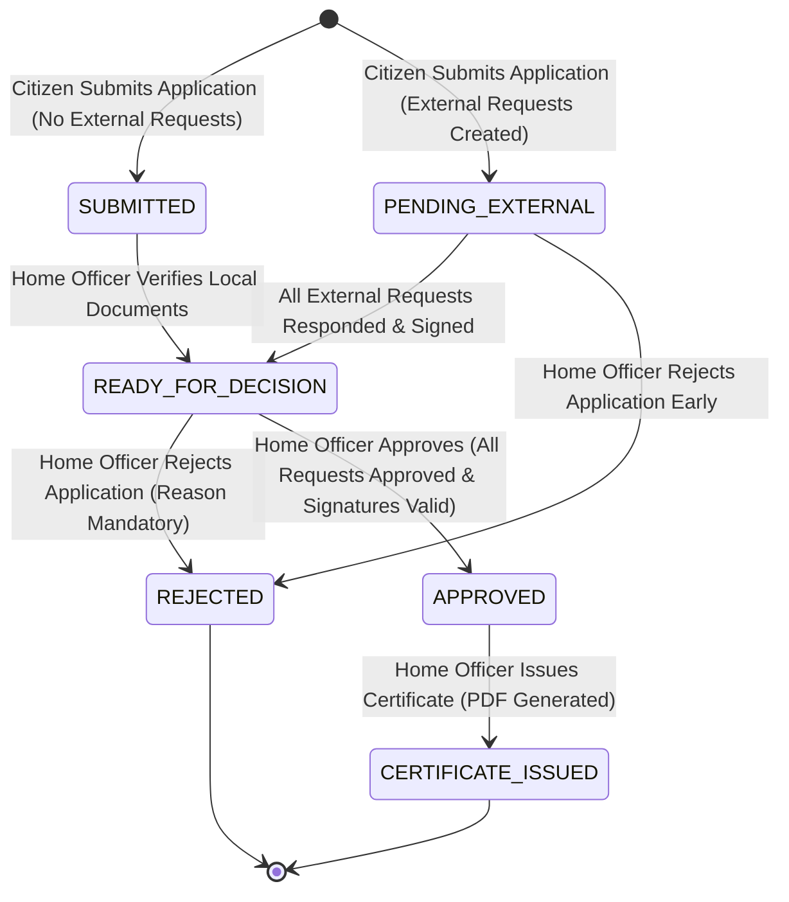

# System Architecture — Connected Panchayat

## 1. System Overview

Connected Panchayat is architected as a decoupled, multi-tiered digital governance platform designed for high integrity, auditable record verification, and strict institutional privacy between local administrative units (Grama Panchayats).

The system follows a classic **Client-Server-Database** architecture with specialized subsystems for cryptographic signing, sequence generation, dynamic PDF synthesis, and background event notification.

---

## 2. High-Level Component Diagram

---

## 3. End-to-End Inter-Panchayat Verification Sequence

The sequence diagram below models the complete lifecycle of a cross-jurisdiction application (e.g., EWS or Income Certificate) where the applicant resides in **Panchayat A** but requires ancestral/property validation from **Panchayat B**.

---

## 4. Digital Signature Cryptographic Flow

Every Grama Panchayat officer is provisioned with a unique, cryptographically strong key pair upon account creation. Private keys never leave the server unencrypted.

---

## 5. Application Lifecycle State Diagram

The application transitions through deterministic states enforced strictly by database transactions and business rule validations.

---

## 6. Key Design Decisions

1. **Parameterless Canonical Representation**:  
   To prevent JSON formatting discrepancies across runtimes, payloads are serialized with sorted keys and normalized whitespace before generating SHA-256 digests.
2. **Stateless JWT with Database Status Checks**:  
   JWT tokens contain authorization claims, but real-time database queries ensure deactivated users (`status = 'INACTIVE'`) are intercepted immediately without waiting for token expiry.
3. **Double Redundancy PDF Verification**:  
   Certificates are verified both by their high-entropy unique `verification_code` and by recalculating the SHA-256 cryptographic hash of the PDF file stored on disk to detect physical file tampering.
