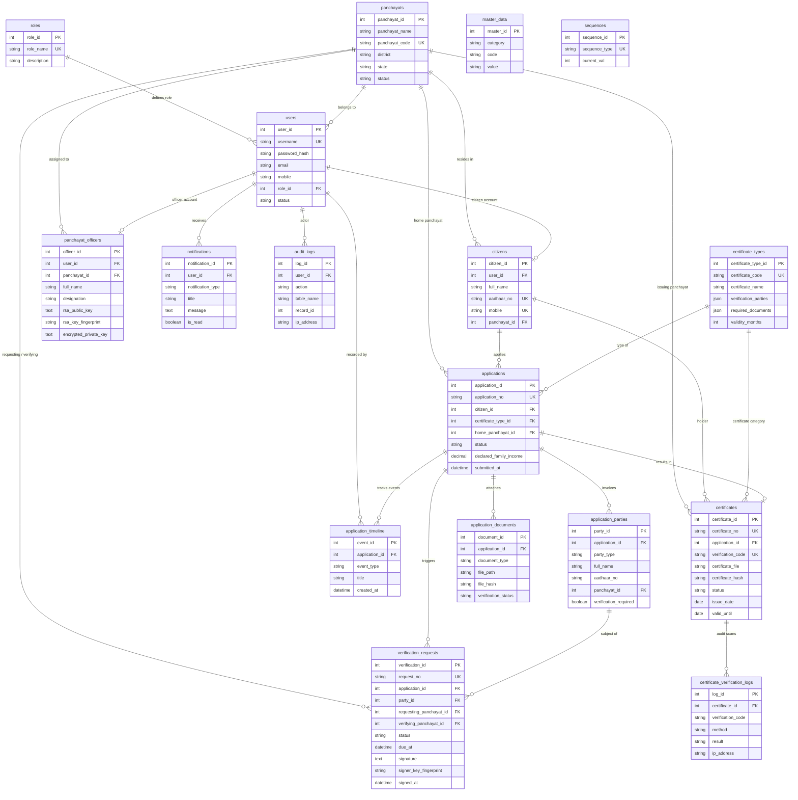

# Database Architecture & Entity-Relationship Model

## 1. Overview

The Connected Panchayat database schema is designed in **Third Normal Form (3NF)** with strict referential integrity, foreign key cascades, and unique composite indexes to prevent race conditions during sequence generation and concurrent state transitions.

The database runs on **MySQL 8.x (InnoDB Engine)** with `utf8mb4_unicode_ci` collation.

---

## 2. Entity-Relationship Diagram (ERD)

---

## 3. Table Descriptions & Specifications

### 1. `roles`
Stores authorization role definitions (`CITIZEN`, `OFFICER`, `ADMIN`). Every user references exactly one role, which controls endpoint access and permission scopes throughout the platform.

### 2. `panchayats`
Holds primary directory details for all local administrative bodies in Kerala, including the official name, short unique code (e.g., `KTR`, `KLM`, `KDK`, `ANC`), district, official contact details, and activation status.

### 3. `users`
Central authentication store containing login credentials (username, Bcrypt-hashed password, email, mobile), role foreign key, and active/inactive status flag used by the auth middleware on every authenticated request.

### 4. `citizens`
Stores demographic profiles for registered residents, linked 1-to-1 with `users`. Contains full name, masked Aadhaar reference, mobile, address, and a foreign key to their home Panchayat.

### 5. `panchayat_officers`
Stores officer service records and cryptographic credentials linked 1-to-1 with `users`. Contains official designation, assigned Panchayat ID, RSA-2048 public key PEM, 64-character SHA-256 key fingerprint, and the AES-256-GCM encrypted private key container.

### 6. `certificate_types`
Configures the 6 supported certificate types (EWS, Income, Residence, Nativity, Family Membership, Possession). Contains JSON definitions for required multi-party validations (`verification_parties`) and mandatory uploaded attachments (`required_documents`).

### 7. `applications`
Core lifecycle registry for certificate applications. Stores human-readable application numbers (e.g., `EWS-2026-0001`), applicant citizen reference, certificate type, declared income/land metrics, and current workflow status (`SUBMITTED`, `PENDING_EXTERNAL`, `READY_FOR_DECISION`, `APPROVED`, `REJECTED`, `CERTIFICATE_ISSUED`).

### 8. `application_parties`
Tracks individual family members, deceased relatives, or land parcels associated with an application. Identifies whether external cross-panchayat verification is required (`verification_required = 1`) based on residence outside the home Panchayat.

### 9. `application_documents`
Registry of uploaded PDF and image attachments for each application. Stores disk storage path, MIME type, file size, SHA-256 file checksum, and verification audit flags (`PENDING`, `VERIFIED`, `REJECTED`).

### 10. `verification_requests`
Maintains inter-panchayat digital verification workflows. Links requesting and verifying Panchayats, subject party, 7-day statutory deadline (`due_at`), reminder counts, digital signature metadata (RSA signature, public key, timestamp, fingerprint), and final response decisions (`APPROVED` or `REJECTED`).

### 11. `certificates`
Registry of officially issued certificates. Stores immutable certificate numbers (e.g., `CERT-EWS-2026-0001`), unique alphanumeric verification codes (e.g., `KL-KTR-2026-X8B9Q2`), validity periods, disk file path, and SHA-256 cryptographic file checksums.

### 12. `certificate_verification_logs`
Audit log recording every public verification attempt (via QR code scan or manual code entry). Records timestamp, client IP address, verification method (`QR` vs `CODE`), and verification result (`VALID`, `INVALID`, `NOT_FOUND`, `EXPIRED`).

### 13. `application_timeline`
Chronological audit history of milestones for every application (submission, document reviews, reminders sent, responses received, approvals, and issuance).

### 14. `notifications`
In-app and email alert queue for users. Stores notification types, title, message text, unread state, and email delivery dispatch status.

### 15. `audit_logs`
Immutable compliance log recording user actions across the platform (logins, registrations, status modifications, key downloads, and decisions) along with actor ID and IP addresses.

### 16. `master_data`
System settings and lookup constants, including the 24-hour reminder cooldown setting (`REMINDER_COOLDOWN_HOURS`) and standard document type classifications.

### 17. `sequences`
Thread-safe counter table with row-level locking (`SELECT FOR UPDATE`) to guarantee unique, gapless sequence numbers for applications, requests, and issued certificates.
